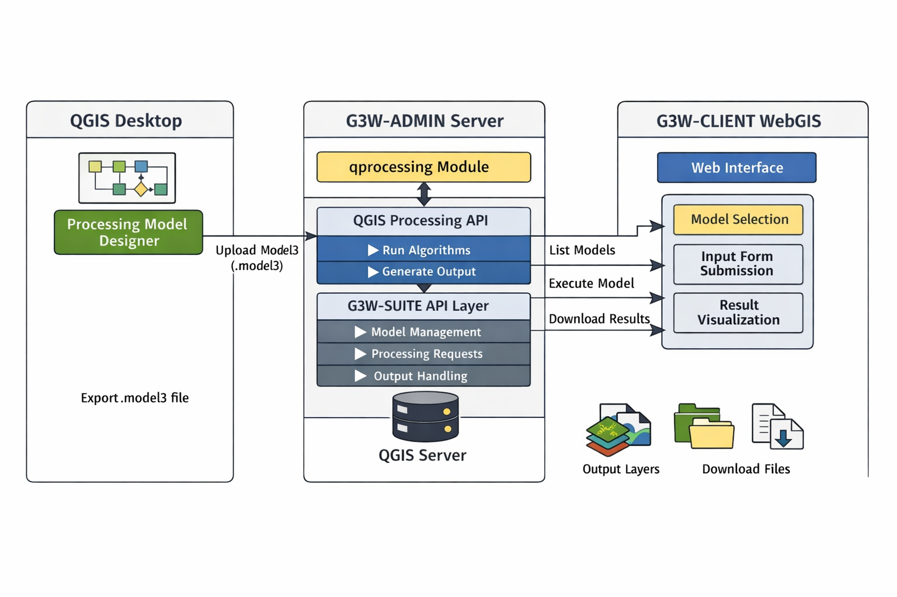
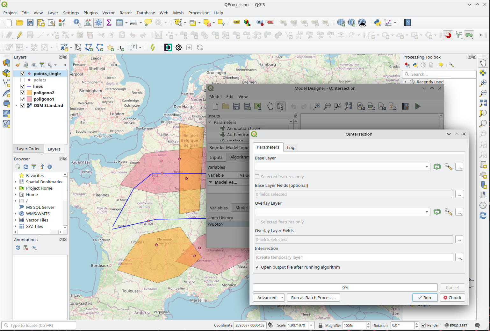
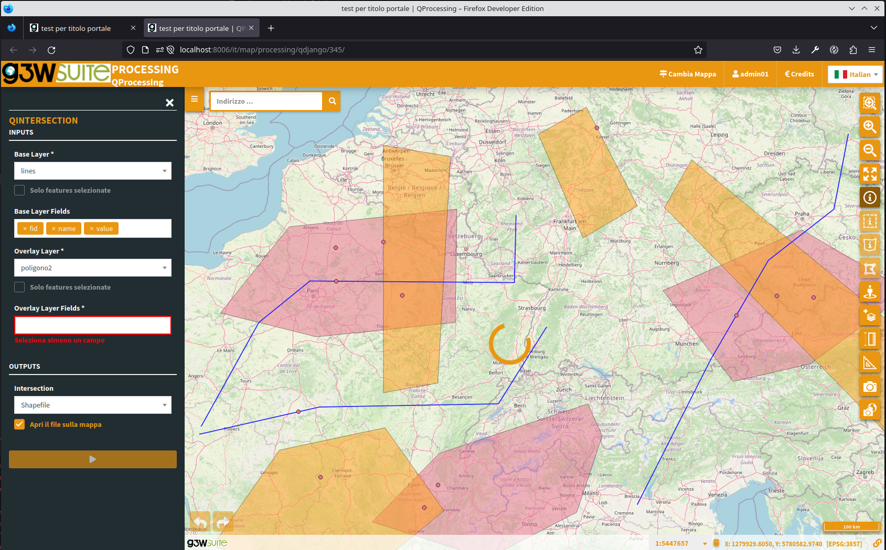

# G3W-ADMIN-PROCESSING

[](https://pypi.org/project/g3w-admin-processing/)
[](https://deepwiki.com/g3w-suite/g3w-admin-processing)

Run [QGIS Processing](https://docs.qgis.org/3.28/en/docs/training_manual/processing/index.html)
models from G3W-CLIENT. Upload a `.model3` file in G3W-ADMIN, associate it with
one or more projects, and make it available to authorized users.



## Installation

Install the package in the Python environment used by G3W-ADMIN:

```sh
pip install g3w-admin-processing
```

For local development, install from a checkout instead:

```sh
pip3 install -e /g3w-suite-docker/plugins/qprocessing
```

The Django application is named **`qprocessing`**. Add it to the existing list in G3W-ADMIN's
`local_settings.py`:

```python
G3WADMIN_LOCAL_MORE_APPS = [
    ...
    'qprocessing',
    ...
]
```

Run G3W-ADMIN's migrations and restart the application:

```sh
python manage.py migrate
```

For Docker deployments, see
[g3w-suite-docker](https://github.com/g3w-suite/g3w-suite-docker).

On Ubuntu Jammy, if installation produces an `UNKNOWN` distribution instead of
`g3w-admin-processing`, retry with:

```sh
export DEB_PYTHON_INSTALL_LAYOUT=deb_system
pip install g3w-admin-processing
```

## Use

1. Create a model using the [QGIS graphical modeler](https://docs.qgis.org/3.28/en/docs/user_manual/processing/modeler.html)
   and save it as a `.model3` file.
2. In G3W-ADMIN, open **Processing > Models > Add model**, upload the model,
   select its projects, and configure access.
3. Open an associated project in G3W-CLIENT, provide the model inputs, and run it.

Users need permission to view the project and run the model.




### Supported model parameters

The processing form supports the following QGIS parameter types:

- Vector layer, feature source, and vector field
- Raster layer
- Distance, number, boolean, and extent

Supported outputs are vector layers, raster layers, files, and HTML. Date/time
and range parameters are recognized when a model is read, but their processing
input conversions are not currently implemented.

## Configuration

Set these options in G3W-ADMIN's settings. Defaults are defined in
[`qprocessing/configs.py`](qprocessing/configs.py).

| Setting | Default | Description |
| --- | --- | --- |
| `QPROCESSING_ASYNC_RUN` | `False` | Run models asynchronously when enabled. |
| `QPROCESSING_OUTPUT_PATH` | `/tmp/` | Directory for processing outputs. |
| `QPROCESSING_INPUT_UPLOAD_PATH` | `/tmp/` | Directory for uploaded inputs. |
| `QPROCESSING_INPUT_UPLOAD_MAX_FILE_SIZE` | `None` | Client-side upload size limit in bytes; `None` disables the limit. |
| `QPROCESSING_TASK_INFO_INTERVAL` | `5` | Task status polling interval in seconds. |
| `QPROCESSING_INPUT_SHP_EXTS` | `['shp', 'shx', 'prj', 'dbf', 'shx']` | Required shapefile extensions. |
| `QPROCESSING_CRYPTO_KEY` | See defaults | Fernet key used to encrypt output download links. |

Use writable paths ending in `/`. If you change the output directory and want
uploads in the same location, set both path options.

Set a deployment-specific Fernet key instead of relying on the default:

```sh
python -c "from cryptography.fernet import Fernet; print(Fernet.generate_key().decode())"
```

Store the generated key securely in `QPROCESSING_CRYPTO_KEY` as bytes. Changing
it invalidates existing encrypted download links.

### Formats

Each format setting is a list of dictionaries with `value` and `key` fields.
The defaults are:

| Setting | Default values |
| --- | --- |
| `QPROCESSING_INPUT_UPLOAD_VECTOR_FORMATS` | `zip`, `geojson`, `kml`, `gpkg`, `sqlite` |
| `QPROCESSING_INPUT_UPLOAD_RASTER_FORMATS` | `vrt`, `tiff`, `tif`, `png`, `jpeg`, `jpg` |
| `QPROCESSING_OUTPUT_VECTOR_FORMATS` | `shp`, `geojson`, `kml`, `kmz`, `csv` |
| `QPROCESSING_OUTPUT_RASTER_FORMATS` | `vrt`, `tiff`, `png`, `jpeg`, `jpg` |
| `QPROCESSING_OUTPUT_FILE_FORMATS` | `pdf` |
| `QPROCESSING_OUTPUT_HTML_FORMATS` | `html` |

Default output formats are configured separately:

| Setting | Default |
| --- | --- |
| `QPROCESSING_OUTPUT_VECTOR_FORMAT_DEFAULT` | `geojson` |
| `QPROCESSING_OUTPUT_RASTER_FORMAT_DEFAULT` | `tiff` |
| `QPROCESSING_OUTPUT_FILE_FORMAT_DEFAULT` | `pdf` |
| `QPROCESSING_OUTPUT_HTML_FORMAT_DEFAULT` | `html` |

For example:

```python
QPROCESSING_OUTPUT_VECTOR_FORMATS = [
    {'value': 'shp', 'key': 'Shapefile'},
    {'value': 'geojson', 'key': 'GeoJSON'},
]
QPROCESSING_OUTPUT_VECTOR_FORMAT_DEFAULT = 'geojson'
```

### Asynchronous execution

Models run synchronously by default. To run them asynchronously, configure
Huey and a Redis broker in the G3W-ADMIN environment:

```python
QPROCESSING_ASYNC_RUN = True

HUEY = {
    'huey_class': 'huey.RedisExpireHuey',
    'name': 'g3w-suite',
    'url': 'redis://localhost:6379/?db=0',
    'immediate': False,
    'consumer': {
        'workers': 1,
        'worker_type': 'process',
    },
}
```

Start a Huey consumer alongside G3W-ADMIN:

```sh
python manage.py run_huey -k process
```

The Redis URL must be reachable from the consumer and the application.

## Development and tests

The BDD scenarios live in [`qprocessing/tests/features`](qprocessing/tests/features),
with Python steps in [`qprocessing/tests/steps`](qprocessing/tests/steps).
They require a configured G3W-ADMIN/QGIS environment, PostGIS, and Node.js
(used to execute the JavaScript component test).

Install the test dependencies from this repository:

```sh
pip install -r requirements_test.txt
```

Make the plugin source available as `qprocessing` in G3W-ADMIN, as done in
[CI](.github/workflows/ci.yml). For a test-only Django settings module, import
G3W-ADMIN's test settings and add `behave_django` to `INSTALLED_APPS`:

```python
# base/settings/qprocessing_test_settings.py
from . import *
from .tests_settings import *

INSTALLED_APPS = [*INSTALLED_APPS, 'behave_django']
```

The test settings use an in-memory Huey queue. From the G3W-ADMIN directory,
run:

```sh
python manage.py behave --settings=base.settings.qprocessing_test_settings --simple qprocessing/tests
```

### Automatic releases

After CI succeeds for a push, CD creates and tags an empty commit named after
the version, then publishes to PyPI and GitHub Releases. The commit has the
same content as the tested commit. If the branch advances, CD skips that run
and waits for CI on the latest commit. Release notes include commit messages,
authors and links.

**Compatibile with:**
[](https://github.com/g3w-suite/g3w-admin/tree/v.4.0.x)
[](https://github.com/g3w-suite/g3w-suite-docker/tree/v4.0.x)

---

**License:** MPL-2
